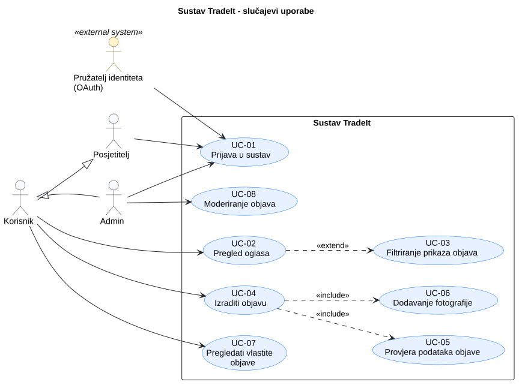

# 3. Obrasci uporabe

**Cilj:** Prikazati glavne interakcije između aktera aplikacije i sustava. Opišite kako akter ostvaruje cilj i što se događa kada važan korak ne uspije. Interakcije temeljite na odobrenim zahtjevima i ažurirajte ih kako se aplikacija razvija.

## 3.1 Dijagram obrazaca uporabe

**Cilj:** Prikazati granicu sustava, relevantne aktere i njihove glavne ciljeve u **preglednom UML dijagramu obrazaca uporabe**. Ako je za razumijevanje pojedinog dijela sustava potrebno prikazati više detalja, taj dio izdvojite u dodatni usmjereni dijagram. Dodatni dijagrami trebaju produbiti dio preglednog modela, a ne stvarati nepovezane ili duplicirane prikaze istog sustava.

**Slika 3.1. Dijagram obrazaca uporabe sustava RentIt**

**PlantUML izvor:** [izvor](./puml/use-case-diagram.puml)

**Provjera dijagrama:** Prikažite prepoznate uloge koje **komuniciraju s aplikacijom**, a ne dionike koji s njom nemaju interakciju. Svaki glavni korisnički cilj mora imati pridruženog aktera; uključeni obrazac uporabe može se dosegnuti preko drugog obrasca uporabe bez vlastite izravne veze s akterom. `<<include>>` i `<<extend>>` koristite samo kada odnos odgovara stvarnom ponašanju.

## 3.2 Specifikacije obrazaca uporabe

**Cilj:** Za svaki obrazac uporabe iz dijagrama objasniti cilj aktera, uobičajenu interakciju s aplikacijom i važne alternative. Jednostavne obrasce uporabe opišite kratko; proširite one kod kojih alternative, vanjske ovisnosti ili posljedice zahtijevaju dodatno objašnjenje.

**Za svaki obrazac uporabe koristite jednu okomitu tablicu.** Navedite samo onoliko pojedinosti koliko interakcija zahtijeva; neprimjenjivu alternativu izostavite umjesto da je popunjavate samo radi forme.

**UC-001: Registracija računa putem vanjskog Oauth sustava.**

| Polje | Opis |
| --- | --- |
| Primarni akter | Korisnik |
| ID zahtjeva | F-001 |
| Preduvjeti, ako postoje | Nema. |
| Glavni tijek | 1. Korisnik pokreće registraciju. 2. Uspješna autentikacija povezuje isti vanjski identitet s jednim računom. 3. Novi račun dobiva korisničku ulogu. |
| Alternativni ili neuspješni tijekovi, ako postoje | Odjava poništava aplikacijsku sesiju. Neuspješna ili prekinuta prijava ne stvara prijavljenu sesiju. |
| Rezultat | Korisnik je registriran. |

**UC-002: Izrada oglasa**

| Polje | Opis |
| --- | --- |
| Primarni akter | Korisnik |
| ID zahtjeva | F-003 |
| Preduvjeti, ako postoje | Korisnik registriran. |
| Glavni tijek |1. Korisnik pokreće akciju. 2. Korisnik ispunjuje oglas. (Obvezni su naziv, vrsta ponude, kategorija, opis, fotografija fizičkog predmeta, cijena s jedinicom obračuna, lokacija i uvjeti korištenja.) 3. Korisnik objavljuje oglas. |
| Alternativni ili neuspješni tijekovi, ako postoje | Sustav odbija nepotpun unos uz poruku uz odgovarajuće polje.  |
| Rezultat | Objava napravljena. |

**UC-003: Pregled kataloga oglasa**

| Polje | Opis |
| --- | --- |
| Primarni akter | Korisnik |
| ID zahtjeva | F-004 |
| Preduvjeti, ako postoje | Korisnik registriran. |
| Glavni tijek | Detalji prikazuju opis, fotografije kada su primjenjive, cijenu i jedinicu obračuna, javnu lokaciju, raspoloživost, uvjete te profil ponuditelja.  |
| Alternativni ili neuspješni tijekovi, ako postoje | - |
| Rezultat | Prikaz oglasa. |

**UC-004: Zahtjev za najam**

| Polje | Opis |
| --- | --- |
| Primarni akter | Korisnik |
| ID zahtjeva | F-007 |
| Preduvjeti, ako postoje | Korisnik registriran. |
| Glavni tijek | 1. Korisnik odabire termin za najam i vidi izračun cijene te uvjete koje potvrđuje prije slanja. 2. Poslužitelj provjerava oglas, datume i raspoloživost te prihvaća odnosno odbija. |
| Alternativni ili neuspješni tijekovi, ako postoje | Ponovljeno slanje iste radnje ne stvara dodatni zahtjev. Vlastiti oglas i nevaljan termin nije moguće rezervirati. |
| Rezultat | Zahtjev prihvaćen ili odbijen. |

**UC-005: Moderiranje oglasa**

| Polje | Opis |
| --- | --- |
| Primarni akter | Administrator |
| ID zahtjeva | F-006 |
| Preduvjeti, ako postoje | Administrator je prijavljen i ima administratorske ovlasti; postoji oglas koja čeka pregled. |
| Glavni tijek | 1. Administrator odabire oglas koji čeka pregled 2. Administrator odobri odnosno odbije oglas. |
| Alternativni ili neuspješni tijekovi, ako postoje | - |
| Rezultat | Prijava ima novi status ako je administratorska radnja uspješno provedena; inače ostaje nepromijenjena. |

---

## 3.3 Provjera dosljednosti obrazaca uporabe

**Cilj:** Provjeriti međusobnu usklađenost obrazaca uporabe, aktera, zahtjeva i ispitnih slučajeva. Cjelovito mapiranje održava se isključivo u **[matrici sljedivosti zahtjeva](2-Analiza-zahtjeva.md#26-sljedivost-zahtjeva)**.

Dosljednost se prati u **[matrici sljedivosti zahtjeva](2-Analiza-zahtjeva.md#26-sljedivost-zahtjeva)**, ne ovdje.

---

Povezivanje zahtjev → obrazac uporabe → ispitivanje održavajte **samo jednom, u [tablici sljedivosti zahtjeva](./2-Analiza-zahtjeva.md)**. Ovdje nemojte održavati drugu projektnu tablicu mapiranja ni stupac sa statusom implementacije. Ako važan zahtjev nema interakciju s ljudskim akterom, objasnite gdje se obrađuje umjesto izmišljanja aktera.

**Završna provjera:** Dijagram, specifikacije obrazaca uporabe i matrica sljedivosti međusobno su usklađeni. Svaki važan obrazac uporabe povezan je s postojećim zahtjevom, akteri odgovaraju stvarnim ulogama u aplikaciji, a opisani glavni i alternativni tijekovi odgovaraju ponašanju koje sustav stvarno podržava.
